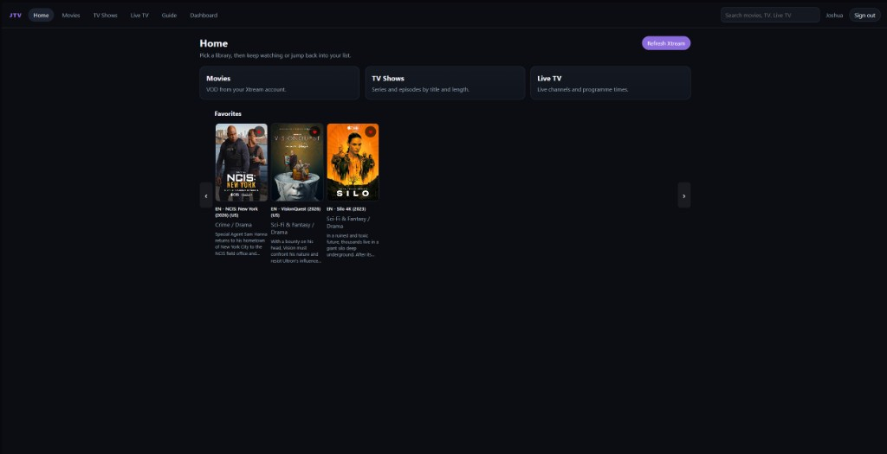
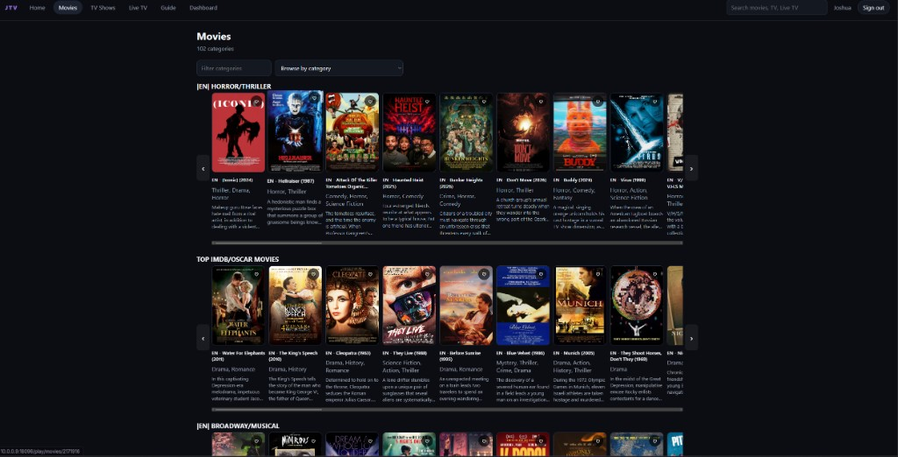
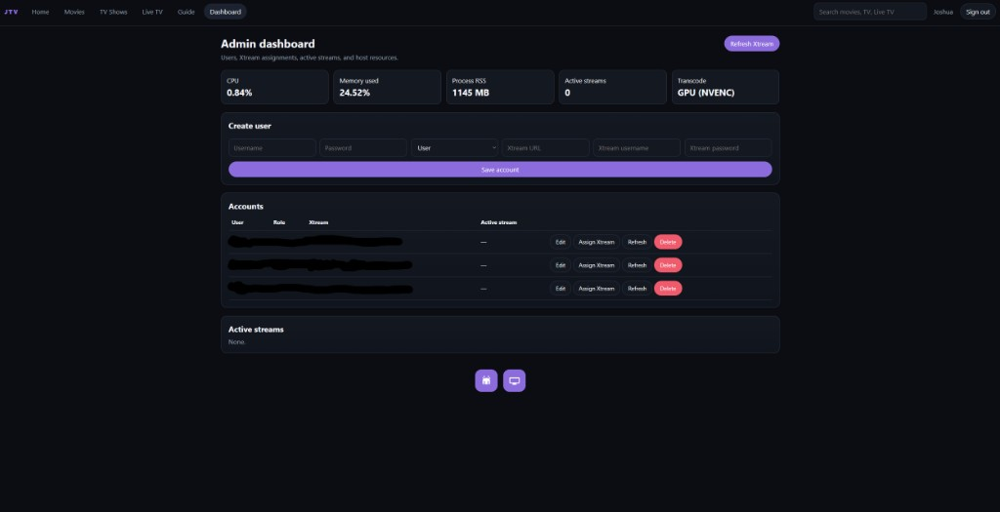

# JTV

JTV is a Jellyfin-style media server for **Movies**, **TV Shows**, and **Live TV**. **Each JTV account has its own Xtream Codes login.** Do not share one Xtream user across several JTV accounts — that causes **404** and **permission denied** on streams. The web UI includes posters, search, favorites, continue watching, and a TiviMate-style live TV guide.

The **JTV player app will be on Google Play soon.** This repository describes the product. It does not include the player application.

## What JTV does

- **Home** — continue watching, favorites, and library shelves
- **Movies** — poster grid, details, playback
- **TV Shows** — series, seasons, and episodes
- **Live TV** — channels plus an EPG-style **Guide**
- **Search** — movies, series, and live channels
- **Favorites** — star titles and live channels
- **Dashboard** — admins manage users, assign a **separate Xtream Codes login to each account** (required to avoid 404 / permission denied), watch host CPU/memory, and download the Android / Android TV / Xbox apps from buttons at the bottom of the page
- **Playback** — remux when the client can handle it, HLS transcode as fallback (GPU NVENC when available)

## Screenshots

Home, with library shortcuts and favorites:



Movies, with categories and poster rows:



Admin dashboard, with accounts, Xtream assignment, and app download buttons:



JTV is a player-and-server for a **server you run**. It does not include Netflix, Disney+, or any other streaming subscription.

## How it is put together

```
Your Ubuntu box (JTV server, port 18096)
        │
        ├── browser:  http://YOUR_SERVER:18096
        └── player:   coming to Google Play soon
                      (enter the same server address, then sign in)
```

The player is a remote client, like Jellyfin’s apps. It asks for the server address, you sign in, then you browse and play. It does **not** host JTV on the phone or TV.

Default web admin login on a new install is `admin` / `changeme`. Change that immediately.

## Run the server (Ubuntu + Docker)

Host port **18096** is used so it does not collide with Jellyfin on 8096.

```bash
sudo apt update
sudo apt install -y docker.io docker-compose-v2
sudo usermod -aG docker "$USER"
# log out and back in so docker works without sudo

# copy your JTV server package onto the machine, then:
cd ~/jtv
chmod +x install-ubuntu.sh
./install-ubuntu.sh
```

If the firewall is on: `sudo ufw allow 18096/tcp`. Library data lives in a Docker volume. Open `http://YOUR_SERVER:18096`, sign in, and in the Dashboard give **each user a separate Xtream Codes username and password**. Sharing one Xtream account between JTV users leads to **404** and **permission denied** errors.

## Xtream Codes (one login per JTV user)

JTV talks to your provider with the Xtream credentials stored on **that** JTV account.

- Assign a **unique** Xtream user to every JTV user in the Dashboard.
- Two people signed into JTV at once with the **same** Xtream code will hit connection limits and get **404** or **permission denied**.
- Playback, Live TV, and the guide all use that per-account Xtream login, so a missing or shared code shows up as those errors rather than a JTV bug.

## Player

The JTV player app **will be available on Google Play soon**.

When it ships, you will:

1. Install JTV from Google Play
2. Enter `http://YOUR_SERVER:18096` (not `localhost`)
3. Sign in with the username and password from your JTV server

Until then, the admin Dashboard has **Android**, **Android TV**, and **Xbox** download buttons at the bottom of the page. Xbox sideloads the Android TV build in Developer Mode.

Keep the device on the same network as the server unless you expose JTV yourself.

## Privacy

See [PRIVACY.md](PRIVACY.md). JTV is self-hosted. The upcoming Play Store player only talks to the server address you enter.

## Status

- Server and web UI: in use on Ubuntu (Docker)
- Player app: **coming to Google Play soon** (not included in this repository)
